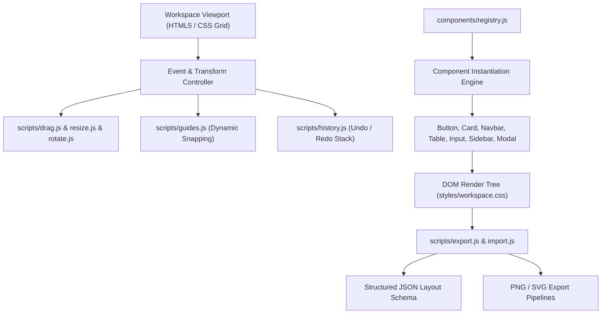

<div align="center">
  <h1>wirecanvas</h1>
  <p>Lightweight browser-based low-fidelity UI wireframe editor with drag-and-drop workspace, reusable components, and vector export.</p>

  <p>
    <a href="https://github.com/itsgoharrehman/wirecanvas/releases"></a>
    <a href="LICENSE"></a>
    
    
    <a href="https://github.com/itsgoharrehman/wirecanvas/stargazers"></a>
    <a href="https://github.com/itsgoharrehman/wirecanvas/issues"></a>
  </p>
</div>

---

## Overview

wirecanvas is an interactive, browser-based low-fidelity wireframing and prototyping application. Designed for rapid software interface ideation, it provides a distraction-free drag-and-drop workspace with snap-to-grid alignment guides, modular component registries, real-time bounding box transformations, undo/redo history, and native JSON layout serialization.

The application executes entirely on client-side web standards, enabling offline design workflows with vector and raster image export.

## Architecture and Workspace Model



## Core Capabilities

### 1. Extensible Component Registry (`components/`)
* **Navigation & Layout**: Navbars, sidebars, breadcrumb trails, tabs, cards, and modal dialogs.
* **Form Primitives**: Styled low-fidelity buttons, text inputs, textareas, checkboxes, radio groups, and searchbars.
* **Content Blocks**: Avatars, badges, dividers, progress bars, tables, block text, and image placeholders.
* **Vector Primitives**: Geometric arrows, lines, rectangles, and circles.

### 2. Workspace & Transformation Engine (`scripts/`)
* **Interactive Drag & Drop**: Bounded coordinate movements with magnetic snap-to-grid guides.
* **Eight-Point Bounding Resize & Rotation**: Live aspect-ratio scaling and rotational manipulation.
* **Layer Depth Ordering**: Bring to front, send to back, group selection (`Ctrl+G`), and multi-element alignment.
* **History Management**: Granular state snapshots with bidirectional undo/redo (`Ctrl+Z` / `Ctrl+Y`).

### 3. Layout Serialization & Export
* **JSON Schema**: Full serialization of canvas elements, geometry, z-indices, and styling properties.
* **Asset Export**: Export wireframes to high-resolution PNG images or vector SVG diagrams.

## Prerequisites

* Modern web browser (Chrome 80+, Firefox 75+, Safari 13+, Edge 80+).
* Node.js 18+ (required for local Vite development server).

## Installation and Quickstart

### 1. Clone the Repository

```bash
git clone https://github.com/itsgoharrehman/wirecanvas.git
cd wirecanvas
```

### 2. Install Dependencies

```bash
npm install
```

### 3. Start Development Server

```bash
npm run dev
```

Open `http://localhost:5173` in your browser.

### 4. Production Build

```bash
npm run build
npm run preview
```

## Keyboard Shortcuts

| Shortcut | Action |
| :--- | :--- |
| `Ctrl + Z` (`Cmd + Z`) | Undo last action |
| `Ctrl + Y` (`Cmd + Shift + Z`) | Redo last action |
| `Delete` / `Backspace` | Remove selected component(s) |
| `Ctrl + D` (`Cmd + D`) | Duplicate selected component |
| `Ctrl + G` (`Cmd + G`) | Group selected components |
| `Ctrl + Shift + G` | Ungroup components |
| `Arrow Keys` | Nudge element position (1px) |
| `Shift + Arrow Keys` | Nudge element position (10px grid snap) |
| `Ctrl + S` (`Cmd + S`) | Save layout to local storage / download JSON |

## Component Registry Specification

Components implement a uniform lifecycle interface in `components/registry.js`:

```javascript
export const ComponentDefinition = {
    type: 'button',
    label: 'Button Component',
    category: 'Forms',
    defaultProps: {
        width: 120,
        height: 36,
        text: 'Action',
        variant: 'primary'
    },
    render: (props) => HTMLElement
};
```

## Security Considerations

* **Safe JSON Import**: Imported JSON layout files are validated against rigid property schemas before DOM creation, preventing arbitrary script injection.
* **SVG Sanitization**: Exported and imported vector markup strips inline `<script>` tags, event attributes (`onload`, `onerror`), and foreign namespaces.
* **Offline Privacy**: No canvas telemetry, user designs, or keystrokes are transmitted to remote servers.

## License and Security Contact

This project is licensed under the [MIT License](LICENSE).

For security reports, please review [SECURITY.md](SECURITY.md) or contact `goharrehmanfsd260@gmail.com`.